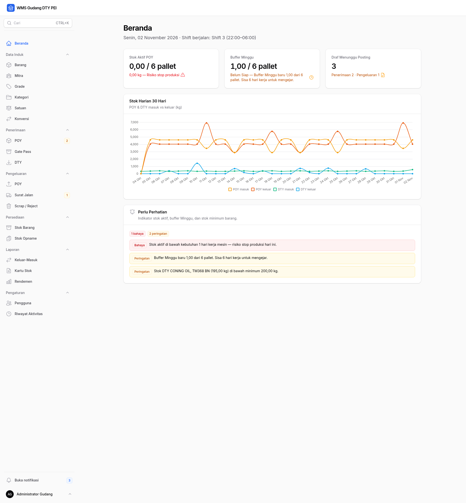

# WMS Gudang DTY

Sistem manajemen gudang untuk pabrik teksturisasi benang DTY. Aplikasi
mencatat penerimaan bahan baku POY, pengeluaran untuk produksi,
penerimaan produk jadi DTY, pengiriman, persediaan, buffer Minggu, dan
laporan operasional dalam satu panel admin.




## Fitur

- **Beranda** — stok aktif POY, status buffer Minggu beserta aksi rilis,
  draf yang menunggu posting, grafik 30 hari, dan daftar perhatian.
- **Data Induk** — Barang, Mitra, Grade, Kategori, Satuan, dan Konversi.
- **Penerimaan** — POY, Gate Pass item pendukung, dan DTY hasil produksi.
- **Pengeluaran** — POY ke produksi, Surat Jalan DTY, dan Scrap/Reject.
- **Persediaan** — Stok Barang dan Stok Opname.
- **Laporan** — Keluar-Masuk, Kartu Stok, dan Rendemen dengan ekspor
  Excel/PDF serta cetak.
- **Notifikasi database** di sidebar untuk peringatan stok dan buffer.
- **Global search** dengan shortcut **Ctrl+K** atau **⌘K**.
- **Pengguna dan riwayat aktivitas** untuk manajemen akun dan audit trail.
- **Cetak dokumen** Gate Pass dan Surat Jalan siap cetak.
- **Role-based access** untuk Admin, Operator, dan Manajer.

## Tech stack

| Lapisan | Teknologi | Versi |
| --- | --- | --- |
| Bahasa | PHP | 8.3+ |
| Framework | Laravel | 13.35 |
| Panel admin | Filament | 5.11 |
| Reaktivitas | Livewire | 4.4.8 |
| Database | MySQL 8 / MariaDB | — |
| Test | PHPUnit | 12.5 |
| Formatter | Laravel Pint | 1.32 |
| Export PDF | `barryvdh/laravel-dompdf` | 3.1.2 |
| Export Excel | `maatwebsite/excel` | 4.0.6 |
| Build | Vite | 8.3.5 |
| Vite plugin | `laravel-vite-plugin` | 3.2.0 |

## Quick start

### Prasyarat

- PHP 8.3+ dengan ekstensi Laravel umum (`openssl`, `pdo`, `pdo_mysql`,
  `mbstring`, `tokenizer`, `xml`, `ctype`, `json`, `bcmath`, `fileinfo`,
  `gd`)
- Composer
- Node.js 20+ dan npm
- MySQL 8 atau MariaDB

### Instalasi

```bash
composer install
npm install
cp .env.example .env
php artisan key:generate
```

Sesuaikan koneksi database di `.env`. Lalu pilih salah satu:

```bash
# Opsi A — impor dump (sudah berisi data demo)
mysql -u root -p -e "CREATE DATABASE IF NOT EXISTS db_wms_gudang_dty CHARACTER SET utf8mb4 COLLATE utf8mb4_general_ci;"
mysql -u root -p db_wms_gudang_dty < database_backup/db_wms_gudang_dty.sql

# Opsi B — migrasi dan seeder
php artisan migrate --seed
```

Build dan jalankan:

```bash
npm run build
php artisan serve
```

Buka `http://127.0.0.1:8000`. Root `/` redirect ke `/admin`, dan login
memakai **email**.

## Akun default

| Role | Email | Password |
| --- | --- | --- |
| Admin Gudang | `admin@wms.local` | `password` |
| Operator Gudang | `operator@wms.local` | `password` |
| Manajer / Supervisor | `manajer@wms.local` | `password` |

Ganti password default melalui **Pengaturan → Pengguna** setelah login
pertama.

## Dokumentasi

Dokumentasi lengkap berada di [`docs/`](docs/README.md).

| Dokumen | Isi |
| --- | --- |
| [Getting Started](docs/getting-started.md) | Instalasi, database, build, login, langkah pertama |
| [Architecture](docs/architecture.md) | Stack, layer, alur request, otorisasi, scheduler |
| [Features](docs/features.md) | Modul, URL, role matrix, lifecycle, screenshot |
| [Business Rules](docs/business-rules.md) | KG, buffer Minggu, rendemen, void, opname |
| [Database](docs/database.md) | 26 tabel, relasi, enum, ERD, data demo |
| [Testing](docs/testing.md) | 201 test, struktur, perintah, menambah test |
| [Deployment](docs/deployment.md) | Checklist produksi, scheduler, queue, backup |
| [Troubleshooting](docs/troubleshooting.md) | Masalah umum dan langkah diagnosis |
| [Contributing](docs/contributing.md) | Conventional Commits, branch, kualitas kode |

## Struktur repositori

```text
app/
├── Filament/       # Resources, pages, widgets, concerns
├── Services/       # Stok, buffer, penerimaan, pengeluaran, laporan
├── Models/         # Model Eloquent
├── Policies/       # Otorisasi per role dan status
├── Exports/        # Export Excel
├── Enums/          # Role, status, jenis transaksi, pos stok
└── Console/        # Command scheduler

config/wms.php      # Konstanta bisnis
database/           # Migrasi dan seeder
database_backup/    # Dump SQL dan panduan impor
docs/               # Dokumentasi proyek
resources/views/    # Blade panel, cetak, PDF
routes/             # Route web dan scheduler
tests/              # PHPUnit feature dan unit test
```

## Testing

```bash
php artisan test       # 201 test lulus, 1068 assertions
vendor/bin/pint        # format kode PHP
npm run build          # build aset frontend
```

Test memakai SQLite in-memory sehingga tidak menyentuh database lokal.

## Status

Implementasi panel Filament dan aturan bisnis inti sudah selesai dan berada
pada tahap **finalisasi dan QA**. Fokus berikutnya adalah hardening
produksi, backup rutin, pemantauan scheduler/queue, dan dokumentasi
operasional.

## Anggota kelompok

- Muhammad Apiransyah Ramdhani
- Reza Asriano Maulana
- Dhafi Ebsan Yurizal

## Lisensi

Proyek ini dilisensikan di bawah **GNU General Public License v3.0 (GPL-3.0)**.
Lihat [LICENSE](LICENSE) untuk teks lengkap dan [AUTHORS](AUTHORS) untuk pemegang hak cipta.

Author / pemegang hak cipta: **Reza Asriano Maulana**. Lihat [AUTHORS](AUTHORS) untuk daftar kontributor.

Kode boleh digunakan, dimodifikasi, dan didistribusikan sesuai ketentuan GPLv3.
Karya turunan yang didistribusikan harus tetap open-source dengan lisensi yang sama.
