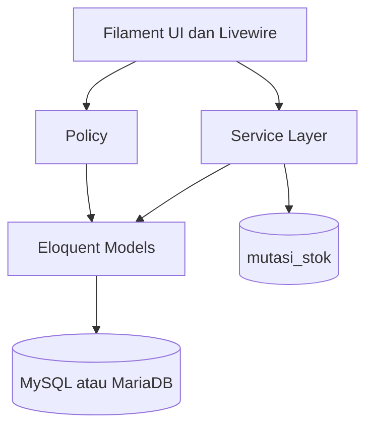
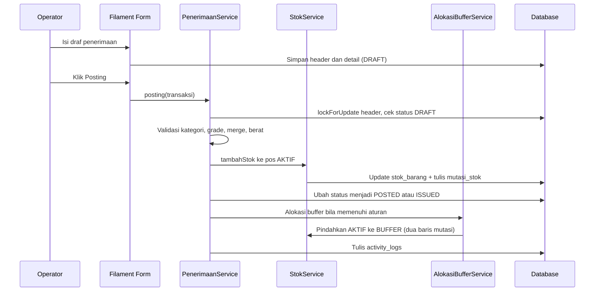

# Architecture

Dokumen ini menjelaskan susunan teknis aplikasi, pembagian tanggung jawab
antar layer, dan alur request utama.

## Stack

| Lapisan | Teknologi | Versi |
| --- | --- | --- |
| Bahasa | PHP | 8.3+ |
| Framework | Laravel | 13.39 |
| Panel admin | Filament | 5.11 |
| Reaktivitas | Livewire | 4.4.8 |
| Database | MySQL 8 / MariaDB | — |
| Export Excel | `maatwebsite/excel` | 4.0.6 |
| Export PDF | `barryvdh/laravel-dompdf` | 3.1.2 |
| Test | PHPUnit | 12.5.42 |
| Formatter | Laravel Pint | 1.32 |
| Build | Vite + `laravel-vite-plugin` | 8.3 / 3.2 |

## Layer



Prinsip utama:

- **Filament UI** menangani form, tabel, filter, widget, notifikasi, dan
  navigasi. UI tidak menulis saldo stok secara langsung.
- **Service layer** memegang aturan bisnis, transaksi database, penguncian
  baris, validasi status, dan pencatatan audit.
- **Model** memetakan tabel, relasi, cast enum, dan scope baca.
- **MySQL/MariaDB** menyimpan saldo, ledger mutasi, transaksi, dan audit.
- **Policy** menentukan akses per role dan per status dokumen.

Konstanta bisnis tidak ditulis di kode. Nilai seperti berat per pallet,
jumlah bobbin per box, ambang buffer, dan format nomor berada di
`config/wms.php`.

## Struktur folder

```text
app/
├── Console/Commands/       # wms:rilis-buffer-minggu, wms:recalculate-stock
├── Enums/                  # Role, status, jenis transaksi, pos stok
├── Exceptions/             # AturanBisnisException, StokTidakCukupException
├── Exports/                # Export Excel laporan
├── Filament/
│   ├── Concerns/           # Trait create/edit/posting/void transaksi
│   ├── Pages/              # Dashboard dan halaman laporan
│   ├── Resources/          # CRUD master, transaksi, stok, pengguna, audit
│   ├── Support/            # DashboardData, mapper form, helper form
│   └── Widgets/            # Ringkasan, grafik, alert
├── Http/Controllers/Admin/ # Endpoint export laporan
├── Models/                 # Model Eloquent
├── Policies/               # Otorisasi per resource
├── Providers/              # Service provider, panel Filament
└── Services/               # Logika stok, buffer, penerimaan, pengeluaran, laporan

config/wms.php              # Single source of truth konstanta bisnis
database/migrations/        # Skema database
database/seeders/           # Master, akun, demo lokal
resources/views/            # Blade panel, cetak, PDF
routes/web.php              # Redirect dan endpoint export
routes/console.php          # Scheduler
tests/Feature/              # Test HTTP, panel, service
tests/Unit/                 # Test unit
tests/Concerns/             # Helper data uji
```

## Alur request penerimaan



Poin penting:

- Seluruh proses berjalan dalam satu `DB::transaction()`.
- Header dikunci dengan `lockForUpdate()` dan status diperiksa ulang
  setelah lock didapat, sehingga double-posting ditolak.
- Baris stok juga dikunci sebelum saldo diubah.
- Status harus menjadi `POSTED` sebelum alokasi buffer, agar pasokan hari
  itu terbaca oleh service buffer.

## Alur request pengeluaran

1. Form membuat transaksi keluar berstatus `DRAFT`.
2. Posting/issue memanggil `PengeluaranService`.
3. Service memvalidasi jenis, kategori barang, grade, merge, catatan scrap,
   dan kecukupan stok aktif.
4. `StokService::kurangiStok()` mengurangi pos `AKTIF` dan menulis mutasi.
5. Untuk Surat Jalan DTY, nomor surat jalan dibuat atomik bila belum ada.
6. Status berubah menjadi `POSTED` atau `ISSUED`, lalu audit dicatat.

Buffer tidak boleh dipakai untuk pengeluaran pada hari kerja. Bila stok
aktif tidak cukup, transaksi ditolak dan seluruh perubahan dibatalkan.

## Otorisasi

- `User` mengimplementasikan `FilamentUser`; hanya user dengan
  `is_active = true` yang boleh masuk panel.
- Role disimpan sebagai enum pada kolom `users.role`.
- `Role::canWrite()` mengizinkan Admin dan Operator.
- `Role::canManage()` hanya mengizinkan Admin.
- Policy per model memetakan aksi `viewAny`, `view`, `create`, `update`,
  `delete`, `posting`, `issue`, dan `void`.
- `PenerimaanPolicy` dan `PengeluaranPolicy` menerima jenis transaksi
  opsional agar resource hanya menyentuh jenis yang dikelolanya.
- Manajer bersifat read-only.
- Stok barang bersifat baca-saja; perubahan hanya melalui service transaksi.
- Pengguna tidak dihapus, melainkan dinonaktifkan.

## Ekspor dan cetak

- Export laporan memakai route `admin.laporan.*` di `routes/web.php`.
- `LaporanExportController` meneruskan filter ke `LaporanService` atau
  class export.
- Excel menggunakan `maatwebsite/excel`; PDF menggunakan dompdf.
- Cetak Gate Pass dan Surat Jalan memakai halaman Filament dengan layout
  cetak khusus tanpa sidebar, sehingga siap dicetak dari browser.
- Halaman cetak hanya membuka dokumen yang sudah diterbitkan atau
  diposting, bukan draf.

## Notifikasi

- Notifikasi memakai tabel `notifications` bawaan Laravel.
- Panel menampilkan drawer notifikasi database di sidebar.
- Seeder demo hanya membuat notifikasi pada environment lokal.
- Aksi bisnis tertentu mengirim notifikasi Filament setelah berhasil,
  misalnya rilis buffer dan proses transaksi.

## Global search

- Global search tersedia di sidebar dan dapat dibuka dengan
  **Ctrl+K** atau **⌘K**.
- Resource master dan transaksi mendaftarkan atribut yang dapat dicari.
- Hasil pencarian mengikuti policy, sehingga user hanya melihat data yang
  boleh diakses.

## Widget dan data dashboard

Dashboard memakai `DashboardData` sebagai sumber data baca-saja:

| Widget | Isi |
| --- | --- |
| `RingkasanOperasionalWidget` | Stok aktif POY, status buffer Minggu, draf menunggu posting |
| `GrafikStokWidget` | Grafik garis 30 hari untuk POY dan DTY masuk/keluar |
| `AlertStokWidget` | Peringatan stok minimum, stok aktif kritis, dan buffer terlambat |

Widget tidak menduplikasi logika mutasi; agregasi diambil dari service dan
model.

## Command dan scheduler

| Command | Kegunaan |
| --- | --- |
| `wms:rilis-buffer-minggu` | Rilis seluruh buffer Minggu ke stok aktif |
| `wms:recalculate-stock` | Hitung ulang snapshot saldo pada ledger mutasi |

Scheduler di `routes/console.php` menjalankan
`wms:rilis-buffer-minggu` setiap **Minggu pukul 05:45** pada zona waktu
aplikasi (`Asia/Jakarta`). Rilis juga dapat dipicu manual dari Beranda
ketika hari Minggu dan masih ada buffer.

## Konkurensi dan integritas

- `nomor_dokumen` memakai unique `(jenis, periode)` dan `lockForUpdate()`
  agar nomor tidak duplikat.
- `stok_barang` memakai unique `(barang_id, merge, grade_id)` dan
  `CHECK` non-negatif.
- `alokasi_buffer` memakai unique `(barang_id, merge, tanggal)` agar satu
  posisi tidak dialokasikan dua kali pada hari yang sama.
- `stok_opname` memakai unique posisi per tanggal dan kolom `selisih_qty`
  generated stored.
- `activity_logs` bersifat append-only.
