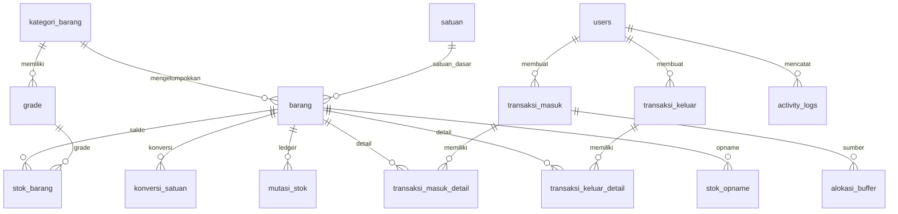

# Database

Database aplikasi berisi **26 tabel** yang terbagi menjadi master,
penomoran, stok, transaksi, audit/autentikasi, dan tabel framework Laravel.
Nama database default adalah `db_wms_gudang_dty` dengan collation
`utf8mb4_general_ci`.

## Kelompok tabel

### Master dan referensi

| Tabel | Isi |
| --- | --- |
| `kategori_barang` | Kategori POY, DTY, dan PENDUKUNG |
| `satuan` | Satuan dasar dan kemasan |
| `grade` | Grade per kategori, termasuk grade scrap |
| `barang` | Master barang dan penanda merge Minggu |
| `supplier_customer` | Supplier, customer, dan partner internal |
| `konversi_satuan` | Faktor konversi satuan per barang atau global |

### Penomoran

| Tabel | Isi |
| --- | --- |
| `nomor_dokumen` | Counter nomor per jenis dan periode |

### Stok dan ledger

| Tabel | Isi |
| --- | --- |
| `stok_barang` | Saldo aktif dan buffer per barang, merge, grade |
| `mutasi_stok` | Ledger masuk/keluar beserta snapshot saldo |
| `alokasi_buffer` | Jejak kebijakan alokasi buffer harian |

### Transaksi

| Tabel | Isi |
| --- | --- |
| `transaksi_masuk` | Header penerimaan |
| `transaksi_masuk_detail` | Baris penerimaan |
| `transaksi_keluar` | Header pengeluaran dan pengiriman |
| `transaksi_keluar_detail` | Baris pengeluaran |
| `stok_opname` | Hasil hitung fisik dan selisih |

### Audit dan autentikasi

| Tabel | Isi |
| --- | --- |
| `users` | Akun, role, dan status aktif |
| `activity_logs` | Audit trail append-only |
| `notifications` | Notifikasi database Laravel |

### Framework Laravel

| Tabel | Isi |
| --- | --- |
| `sessions` | Sesi pengguna |
| `password_reset_tokens` | Token reset password |
| `cache` | Cache store database |
| `cache_locks` | Lock cache |
| `jobs` | Queue job |
| `job_batches` | Batch job |
| `failed_jobs` | Job gagal |
| `migrations` | Riwayat migrasi |

## Kolom dan relasi penting

### `barang`

- `kategori_id` → `kategori_barang.id`
- `satuan_dasar_id` → `satuan.id`
- `kode_barang` unik
- `stok_minimum` dipakai untuk peringatan dashboard
- `is_merge_minggu` menentukan kelayakan alokasi buffer
- `is_active` dan soft delete mencegah pemakaian barang lama
- Relasi: kategori, satuan dasar, stok, konversi, mutasi

### `stok_barang`

- Kunci unik `(barang_id, merge, grade_id)`
- `stok_aktif` dan `stok_buffer` adalah dua pos saldo
- `jumlah_bobbin` dan `jumlah_box` hanya atribut pelengkap
- `CHECK` memastikan kedua saldo tidak negatif
- Relasi: barang dan grade

### `mutasi_stok`

- Mencatat setiap perubahan saldo.
- `pos` menentukan pos yang terdampak: `AKTIF` atau `BUFFER`.
- `masuk_qty` dan `keluar_qty` adalah delta.
- `saldo_akhir_qty` adalah snapshot saldo pos setelah mutasi, bukan
  sumber kebenaran.
- `ref_nomor` menghubungkan mutasi dengan nomor transaksi atau referensi
  buffer.
- Indeks mendukung kartu stok dan laporan keluar-masuk.

### `transaksi_masuk`

- `nomor_transaksi` unik.
- `nomor_gate_pass` unik dan nullable, khusus dokumen Gate Pass.
- `jenis_masuk` menentukan kategori barang yang sah.
- `merge_poy_asal` menghubungkan DTY hasil produksi dengan POY asal untuk
  rendemen.
- `status` memakai enum bersama.
- `created_by`, `voided_by`, `voided_at`, dan `alasan_void` mendukung audit.

### `transaksi_keluar`

- `nomor_transaksi` unik.
- `nomor_surat_jalan` unik dan nullable, dibuat atomik saat issue.
- `jenis_keluar` menentukan kategori dan lifecycle.
- Header menyimpan data pengiriman dan catatan scrap.
- Status dan kolom void mengikuti pola penerimaan.

### `transaksi_masuk_detail` dan `transaksi_keluar_detail`

- Satu baris = satu kombinasi barang, merge, dan grade.
- Penerimaan memakai `berat_kg`.
- Pengeluaran memakai `berat_netto_kg` dan `berat_gross_kg` opsional.
- Detail masuk dapat menyimpan penanda gross pada `keterangan` untuk DTY.
- Foreign key detail memakai cascade delete terhadap header.

### `alokasi_buffer`

- Kunci unik `(barang_id, merge, tanggal)`.
- `jumlah_kg` adalah porsi yang dipindahkan ke buffer.
- `dilewati = true` menandai pasokan di bawah ambang.
- `sumber_transaksi_masuk_id` menunjuk penerimaan asal.
- Baris tidak dihapus saat void; hanya diberi penanda pada keterangan.

### `stok_opname`

- Kunci unik `(barang_id, merge, grade_id, tanggal)`.
- `stok_sistem_qty` dan `stok_fisik_qty` disimpan.
- `selisih_qty` adalah kolom generated stored.
- `transaksi_masuk_id` atau `transaksi_keluar_id` menunjuk penyesuaian.

### `activity_logs`

- Append-only; hanya memiliki `created_at`.
- `event` berisi `LOGIN`, `LOGOUT`, `CREATE`, `UPDATE`, `DELETE`, `VOID`,
  atau `RELEASE_BUFFER`.
- `modul` dan `ref_id` menghubungkan log dengan objek terkait.
- `user_id` memakai `SET NULL` bila user dihapus secara database.

## Enum dan status

| Kolom | Nilai |
| --- | --- |
| `users.role` | `admin`, `operator`, `manajer` |
| `supplier_customer.jenis` | `SUPPLIER`, `CUSTOMER`, `BOTH`, `INTERNAL` |
| `transaksi_masuk.jenis_masuk` | `POY_IPCI`, `PENDUKUNG_GATEPASS`, `DTY_PRODUKSI`, `ADJUSTMENT_IN` |
| `transaksi_keluar.jenis_keluar` | `POY_PRODUKSI`, `DTY_SURAT_JALAN`, `DTY_SCRAP_REJECT`, `ADJUSTMENT_OUT` |
| `mutasi_stok.jenis_transaksi` | `MASUK`, `KELUAR`, `ADJUSTMENT_IN`, `ADJUSTMENT_OUT`, `ALOKASI_BUFFER`, `RILIS_BUFFER`, `VOID` |
| `mutasi_stok.pos` | `AKTIF`, `BUFFER` |
| Status dokumen | `DRAFT`, `POSTED`, `ISSUED`, `VOID`, `CANCELLED` |
| `activity_logs.event` | `LOGIN`, `LOGOUT`, `CREATE`, `UPDATE`, `DELETE`, `VOID`, `RELEASE_BUFFER` |
| `nomor_dokumen.jenis` | `SURAT_JALAN_DTY`, `GATE_PASS`, `TRX_MASUK`, `TRX_KELUAR` |

## Constraint penting

| Constraint | Tujuan |
| --- | --- |
| Unique `grade(kode, kategori_id)` | Kode grade unik dalam kategori |
| Unique `stok_barang(barang_id, merge, grade_id)` | Satu saldo per posisi |
| Unique `alokasi_buffer(barang_id, merge, tanggal)` | Tidak ada alokasi ganda per hari |
| Unique `stok_opname(barang_id, merge, grade_id, tanggal)` | Satu opname per posisi per hari |
| Unique `nomor_dokumen(jenis, periode)` | Counter nomor tidak ganda |
| Foreign key `restrict` pada master | Mencegah hapus data yang masih dipakai |
| Foreign key `cascade` pada detail | Detail ikut terhapus bersama header |
| `CHECK` saldo non-negatif | Integritas saldo di level database |
| Generated `selisih_qty` | Selisih opname tidak dapat drift |

## ERD ringkas



Relasi tambahan yang tidak digambarkan: `supplier_customer` terhubung ke
header transaksi, `notifications` memakai relasi polymorphic ke user,
dan `nomor_dokumen` berdiri sendiri sebagai counter.

## Data demo

Dump dan seeder lokal menyiapkan:

| Data | Jumlah |
| --- | --- |
| User | 3 |
| Barang | 9 |
| Transaksi masuk | 62 |
| Transaksi keluar | 41 |
| Mutasi stok | 156 |
| Activity log | 143 |
| Notifikasi | 3 |

Data transaksi dan notifikasi demo hanya dibuat saat `APP_ENV=local`.

## Migrasi dan seeder

- Migrasi berada di `database/migrations/`.
- Seeder utama: `DatabaseSeeder`.
- Seeder master: user, kategori/satuan, grade, barang, partner, konversi,
  nomor dokumen.
- Seeder demo lokal: `DemoTransaksiSeeder`, `NotifikasiDemoSeeder`.
- Urutan seeder mengikuti ketergantungan foreign key.

## Dump dan impor

- Dump: `database_backup/db_wms_gudang_dty.sql`.
- Dump manual ini **tidak** membuat database dan **tidak** memakai `DROP TABLE`.
- Import (database tujuan **wajib kosong**):

  ```bash
  mysql -u root -p -e "CREATE DATABASE IF NOT EXISTS db_wms_gudang_dty CHARACTER SET utf8mb4 COLLATE utf8mb4_general_ci;"
  mysql -u root -p db_wms_gudang_dty < database_backup/db_wms_gudang_dty.sql
  ```

- Jika database sudah memiliki tabel, kosongkan atau buat ulang terlebih
  dahulu.
- Dump memuat 26 tabel dan data demo (3 user, 9 barang, 62 masuk, 41 keluar,
  156 mutasi, 143 log, 3 notifikasi).
- Dump dibuat dengan DBX/MariaDB; kompatibel dengan MySQL 8 dan MariaDB,
  collation `utf8mb4_general_ci`.
- Alternatif tanpa dump:

  ```bash
  php artisan migrate --seed
  ```

Panduan impor lengkap ada di
[`database_backup/README.md`](../database_backup/README.md).
