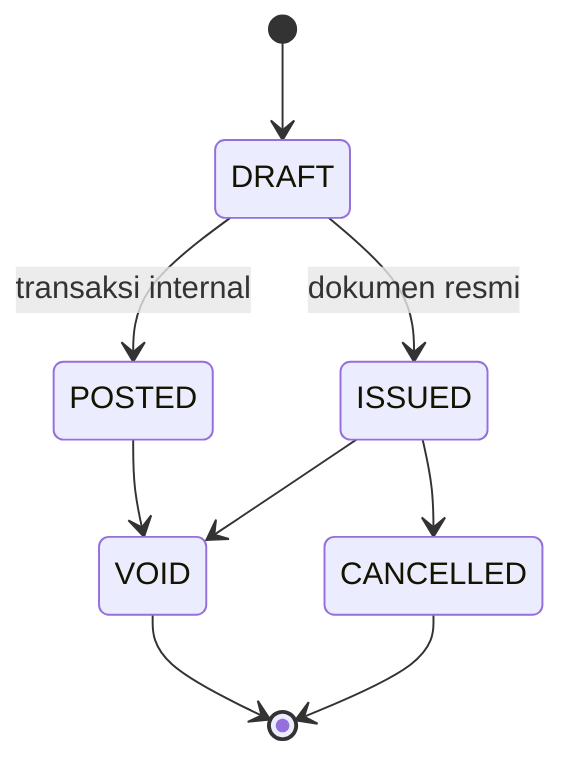

# Features

Seluruh antarmuka aplikasi berada di panel `/admin`. Root `/` redirect ke
`/admin`, dan login memakai email.

## Peta modul

| Grup | Menu | URL | Keterangan |
| --- | --- | --- | --- |
| Beranda | Beranda | `/admin` | Ringkasan operasional dan aksi cepat |
| Data Induk | Barang | `/admin/barangs` | Master barang POY, DTY, dan pendukung |
| Data Induk | Mitra | `/admin/partners` | Supplier, customer, dan partner internal |
| Data Induk | Grade | `/admin/grades` | Grade per kategori |
| Data Induk | Kategori | `/admin/kategori-barangs` | Kategori POY, DTY, PENDUKUNG |
| Data Induk | Satuan | `/admin/satuans` | KG, BOX, PALLET, PCS, BOBBIN |
| Data Induk | Konversi | `/admin/konversi-satuans` | Faktor konversi satuan |
| Penerimaan | POY | `/admin/penerimaan-poy` | Penerimaan bahan baku POY |
| Penerimaan | Gate Pass | `/admin/penerimaan-pendukung` | Item pendukung dengan dokumen resmi |
| Penerimaan | DTY | `/admin/penerimaan-dty` | Produk jadi dari area produksi |
| Pengeluaran | POY | `/admin/pengeluaran-poy` | Pengeluaran POY ke produksi |
| Pengeluaran | Surat Jalan | `/admin/surat-jalan-dty` | Pengiriman DTY |
| Persediaan | Waste / Scrap | `/admin/waste-logs` | Log waste/reject kg tanpa mutasi stok |
| Persediaan | Stok Barang | `/admin/stok-barangs` | Posisi stok aktif dan buffer |
| Persediaan | Stok Opname | `/admin/stok-opnames` | Penyesuaian hasil hitung fisik |
| Laporan | Keluar-Masuk | `/admin/laporan/keluar-masuk` | Arus mutasi per periode |
| Laporan | Kartu Stok | `/admin/laporan/kartu-stok` | Saldo berjalan per posisi |
| Laporan | Rendemen | `/admin/laporan/rendemen` | POY masuk vs DTY keluar |
| Pengaturan | Pengguna | `/admin/users` | Manajemen akun |
| Pengaturan | Riwayat Aktivitas | `/admin/activity-logs` | Audit trail |

## Role matrix

| Kemampuan | Admin | Operator | Manajer |
| --- | --- | --- | --- |
| Melihat dashboard dan laporan | Ya | Ya | Ya |
| Melihat master data | Ya | Ya | Ya |
| Mengubah master data | Ya | Tidak | Tidak |
| Membuat dan mengubah draf transaksi | Ya | Ya | Tidak |
| Posting/issue transaksi | Ya | Ya | Tidak |
| Void transaksi | Ya | Tidak | Tidak |
| Stok opname | Ya | Tidak | Tidak |
| Mengelola pengguna | Ya | Tidak | Tidak |
| Melihat riwayat aktivitas | Ya | Tidak | Tidak |
| Melihat stok barang | Ya | Ya | Ya |
| Ekspor dan cetak laporan | Ya | Ya | Ya |

Manajer adalah role read-only. Operator memakai akun bersama per shift;
nama operator pada transaksi diisi manual.

## Lifecycle status

- `DRAFT` belum mengubah stok.
- `POSTED` dan `ISSUED` sudah memengaruhi stok.
- `VOID` dan `CANCELLED` adalah status final.
- Dokumen resmi adalah Gate Pass dan Surat Jalan DTY; keduanya memakai
  status `ISSUED`.
- Transaksi internal memakai `POSTED`.
- Void tidak menghapus data; mutasi dibalik dan alasan disimpan.

## Beranda

Beranda menampilkan:

- **Stok aktif POY** dalam kg dan pallet, dengan indikator aman atau
  risiko stop produksi.
- **Buffer Minggu** dalam pallet, status siap/belum siap/terlambat, dan
  aksi rilis buffer pada hari Minggu.
- **Draf menunggu posting** untuk penerimaan dan pengeluaran.
- **Grafik 30 hari** untuk POY dan DTY masuk/keluar.
- **Perlu perhatian** berisi stok di bawah minimum, stok aktif kritis,
  dan buffer yang terlambat.

Aksi **Rilis Buffer Minggu** tersedia bagi Admin dan Operator ketika hari
Minggu dan masih ada buffer.

## Data Induk

- **Barang** — kode, nama, kategori, denier, filament, satuan dasar,
  stok minimum, dan penanda merge Minggu.
- **Mitra** — supplier, customer, gabungan, atau internal.
- **Grade** — unik per kategori; grade scrap tetap dipertahankan.
- **Kategori** — POY, DTY, dan item pendukung.
- **Satuan** — satuan dasar dan satuan kemasan.
- **Konversi** — faktor dari satuan kemasan ke KG atau satuan lain.

Perubahan master data hanya dilakukan Admin. Operator dan Manajer dapat
melihat data.

## Penerimaan

### Penerimaan POY

- Berat masuk wajib diisi manual dalam KG hasil timbangan.
- Bobbin dan box hanya atribut pelengkap, bukan dasar saldo.
- Satu baris mewakili kombinasi barang, merge, dan grade.
- Setelah posting, stok aktif bertambah dan buffer dapat dialokasikan
  sesuai aturan Minggu.

### Gate Pass Pendukung

- Untuk paper tube, carton box, oli, pallet, dan item pendukung lain.
- Memakai lifecycle dokumen resmi sampai `ISSUED`.
- Batch hanya metadata informasi (mis. warna paper tube / kode oli); stok item pendukung selalu memakai identitas `merge = -` dan grade `STD`.
- Catatan baris disimpan terpisah dari batch.
- Dapat dicetak sebagai Gate Pass setelah diterbitkan; kolom Batch memakai metadata batch.
- Draf tidak dapat dicetak.

### Penerimaan DTY

- Berat berasal dari hasil produksi.
- Jumlah box hanya mengisi bobbin otomatis.
- Netto dan gross ditimbang manual.
- Merge/batch opsional; kosong disimpan sebagai `-`.
- Merge POY asal wajib diisi untuk identitas produksi.
- Gross dipakai untuk validasi dan toleransi per grade.

## Pengeluaran

### Pengeluaran POY

- Memotong stok aktif, bukan buffer.
- Ditolak bila stok aktif tidak cukup.
- Dapat di-void oleh Admin dengan alasan.

### Surat Jalan DTY

- Memakai lifecycle dokumen resmi sampai `ISSUED`.
- Nomor surat jalan dibuat otomatis dan atomik.
- Dapat dicetak sebagai Surat Jalan.
- Data pengiriman seperti kendaraan dan sopir diisi pada header dokumen.

### Waste / Scrap

- Mencatat waste/reject yarn dalam kg saja: tanpa grade, merge, kode barang, atau kemasan.
- Field: tanggal, jenis (Waste/Reject/Scrap Packaging), tujuan (RCL/EYD/Pengepul/Lainnya), berat kg, dan keterangan opsional.
- Tidak mengurangi stok DTY dan tidak membuat mutasi stok.
- Admin dan Operator dapat membuat catatan; Admin dapat mengubah/menghapus; Manajer read-only.
- Resource lama `Pengeluaran Scrap` tetap ada sebagai legacy tetapi disembunyikan dari navigasi.

## Persediaan

### Stok Barang

- Menampilkan posisi per barang, merge, dan grade.
- Memisahkan `stok_aktif` dan `stok_buffer`.
- Total stok = aktif + buffer.
- Pallet hanya indikator visual, bukan nilai akuntansi.
- Stok barang tidak dapat diubah langsung dari tabel.

### Stok Opname

- Hanya Admin.
- Hanya boleh pada hari terakhir bulan.
- Membandingkan stok sistem (aktif + buffer) dengan stok fisik.
- POY/DTY memakai merge dan grade; item pendukung otomatis memakai `-` dan grade `STD`.
- Selisih positif membuat transaksi penyesuaian masuk.
- Selisih negatif membuat transaksi penyesuaian keluar.
- Satu posisi hanya boleh diopname sekali per tanggal.
- Stok fisik tidak boleh negatif.

## Laporan

### Keluar-Masuk

- Membaca ledger `mutasi_stok`.
- Filter periode, kategori, arus, dan merge.
- Total masuk, keluar, dan bersih.
- Ekspor Excel, PDF, dan cetak.

### Kartu Stok

- Filter barang, merge, grade, pos, dan periode.
- Menampilkan saldo awal dan saldo berjalan.
- Ekspor Excel, PDF, dan cetak.

### Rendemen

- Membandingkan POY masuk dari IPCI dengan DTY keluar lewat Surat Jalan.
- Default periode: 30 hari terakhir termasuk hari ini.
- Menampilkan POY masuk, DTY keluar, rendemen, waste/selisih kg dan %.
- Target bulanan 100 ton beserta pencapaian dan selisih target.
- Memberi peringatan bila DTY keluar lebih besar dari POY masuk (surplus/data tidak valid).
- Menyertakan disclaimer bahwa waste mencakup area, WIP, dan kehilangan proses.
- Ekspor Excel, PDF, dan cetak.

## Pengguna dan riwayat aktivitas

- **Pengguna** — tambah, ubah, nonaktifkan, dan atur role. Pengguna tidak
  dihapus permanen.
- **Riwayat Aktivitas** — mencatat login, logout, create, update, delete,
  void, dan rilis buffer.

Keduanya hanya dapat diakses Admin.

## Notifikasi

- Notifikasi disimpan di tabel `notifications` dan tersedia di drawer sidebar.
- Notifikasi dikirim langsung (sinkron) sehingga tetap tampil tanpa worker
  queue.
- Notifikasi stok menipis dikirim otomatis setelah mutasi stok (penerimaan,
  pengeluaran, alokasi buffer, dan rilis buffer) serta oleh pemeriksaan
  terjadwal setiap jam.
- Pemeriksaan memakai total `stok_aktif + stok_buffer` untuk barang aktif yang
  memiliki `stok_minimum`. Stok aktif POY juga diperiksa terhadap ambang
  6 pallet.
- Penerima hanya pengguna aktif dengan role Admin dan Manajer.
- Notifikasi yang sama tidak dikirim berulang selama kondisi masih menipis.
  Kunci dedup dilepas saat stok kembali aman sehingga peringatan dapat
  terkirim lagi bila kondisi memburuk.
- Seeder demo `NotifikasiDemoSeeder` menjalankan pemeriksaan nyata ini, bukan
  membuat notifikasi contoh palsu.

## Global search

- Buka dengan **Ctrl+K** atau **⌘K**.
- Mencari master data dan transaksi yang diizinkan oleh policy.
- Hasil pencarian menghormati role dan status data.

## Cetak dan ekspor

- **Cetak Gate Pass** untuk penerimaan item pendukung yang sudah diterbitkan.
- **Cetak Surat Jalan** untuk pengiriman DTY.
- **Excel** untuk laporan keluar-masuk, kartu stok, dan rendemen.
- **PDF** dan **Cetak** memakai tampilan laporan khusus.
- Halaman cetak memakai layout tanpa sidebar agar siap dicetak.

## Login

- URL: `/admin/login`.
- Login memakai email.
- Akun default tersedia setelah seeder atau impor dump.
- Ganti password default setelah login pertama.
